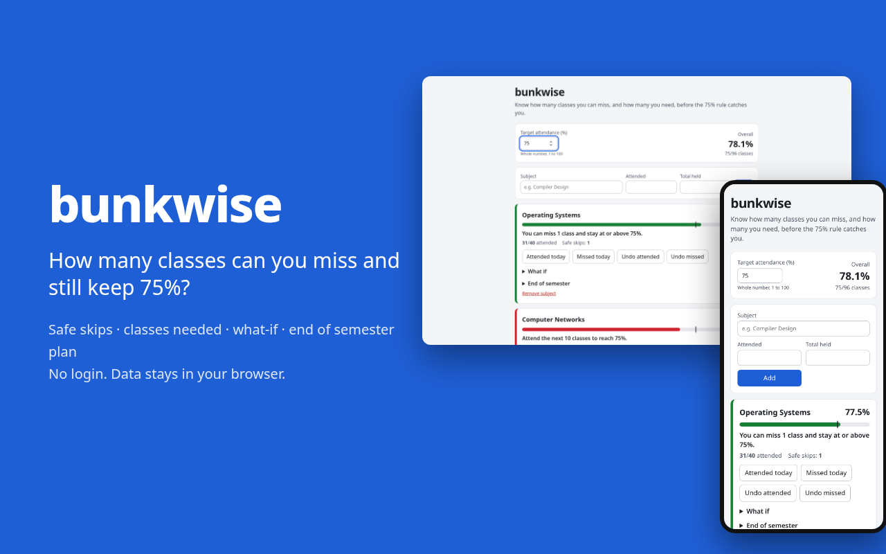
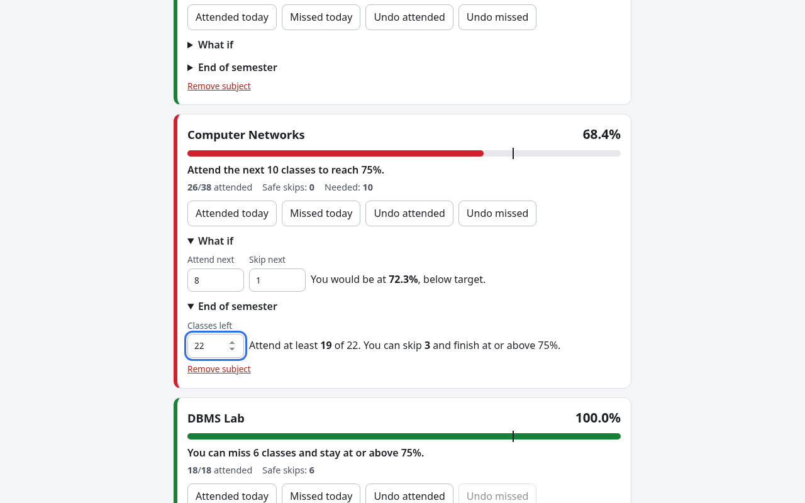
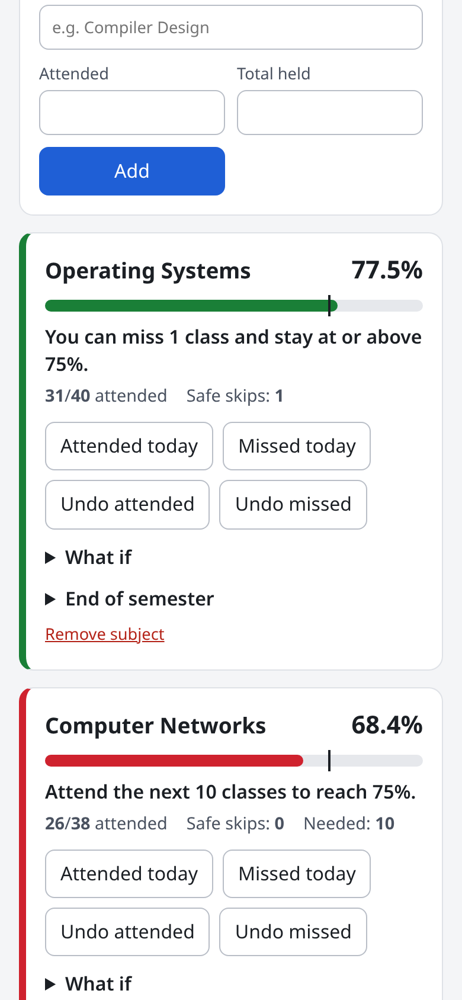

# bunkwise



Live: https://bunkwise-sreecharan-desus-projects.vercel.app

A small web app for college students who have to keep attendance above a fixed percentage (75% at most Indian colleges, including mine). Add your subjects with how many classes you attended and how many were held, and it tells you, per subject:

- your current percentage
- how many upcoming classes you can miss and still stay at or above the target
- if you are already short, how many classes in a row you need to attend to get back
- a "what if" view: attend X and skip Y of the next classes, where do you land
- an end of semester plan: enter how many classes are left and it tells you the fewest you must attend, or that the target is out of reach

It also shows an overall percentage across subjects, since some colleges use that instead.





## Why

Every semester I see friends do this math in their heads and get it wrong, then find out in the last week that they are short in one subject. The rule is simple but the "how many can I miss" question is not obvious, because each class you skip also raises the total.

## Privacy

There is no backend and no login. Everything is stored in your browser's localStorage. You can export a JSON backup and import it on another device.

## The math

With `a` attended, `t` held and a target of `P` percent:

- safe skips = `floor((100a - P t) / P)`, never below 0
- classes needed = `ceil((P t - 100a) / (100 - P))` when you are short
- with `r` classes left in the semester, most you can skip = `floor((100(a + r) - P(t + r)) / 100)`, capped at `r`; if it is below 0 the target cannot be reached

Example: 26 of 38 attended, 22 left, target 75. `floor((4800 - 4500) / 100) = 3`, so attend at least 19 of the 22.

Targets are whole numbers so all of this runs in integers. The tests in `src/attendance.test.ts` check every formula against a brute force loop (all attended and held counts up to 50, and up to 20 remaining classes for the semester plan). 20 tests, run with `npm test`.

## Run it locally

```
npm install
npm run dev      # http://localhost:5173
npm test         # vitest
npm run build    # static build in dist/
```

## Stack

React, TypeScript, Vite, Vitest. Deployed as a static site on Vercel.

## Limitations

- Counts are entered by hand. There is no timetable import or college portal sync.
- Data lives in one browser unless you export and import it.
- It does not know about medical leave or condonation rules, which differ by college.

## License

MIT
